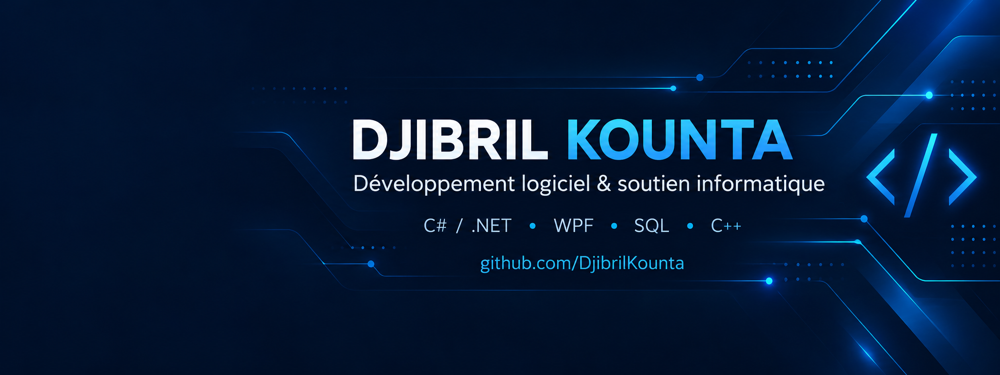

# Djibril Kounta

### Développeur C# / .NET · Applications web et desktop · Soutien informatique

Montréal, Québec · Français et anglais

**À la recherche d’un stage en développement logiciel ou en soutien informatique, ainsi que d’un emploi à temps partiel en TI.**

[Me contacter sur LinkedIn](https://www.linkedin.com/in/djibril-kounta/) · [Explorer mes dépôts](https://github.com/DjibrilKounta?tab=repositories)

## À propos

Je développe des applications à partir de besoins concrets et j’aime comprendre et résoudre les problèmes informatiques. Mon parcours associe le **développement indépendant**, la **réparation d’ordinateurs** et le **service aux utilisateurs**.

Je poursuis un **DEC en techniques de l’informatique au Cégep du Vieux Montréal** depuis 2025. Je suis également titulaire d’une **licence en génie informatique**, obtenue en 2024 à l’Université Libre de Guinée.

## Projets et réalisations

Les projets ci-dessous présentent mon parcours. Leur code source n’est pas publié dans les dépôts publics de ce compte à ce jour.

| Projet | Besoin et fonctionnalités | Technologies |
| --- | --- | --- |
| **ADEBOG** | Application de gestion pour un club de boxe : membres, inscriptions et activités administratives. | C#, SQL Server |
| **DiskMaster** | Application de maintenance système : analyse du stockage, nettoyage des fichiers et gestion de l’espace disque. Inspirée de Windows Disk Cleanup et Storage Sense. | C#, .NET, WPF |
| **Babi Industrie de Tomate** | Conception et personnalisation du site selon les besoins du client. | Développement web |
| **Jeux et prototypes 2D/3D** | Pong, Snake, Space Invaders et divers prototypes Unity. | C++, Raylib, Unity |

### Dépôt en préparation

**[interventions-dotnet](https://github.com/DjibrilKounta/interventions-dotnet)** — Projet de gestion d’interventions de maintenance, avec une stack prévue en C#, ASP.NET Core, PostgreSQL et React/TypeScript. Le dépôt est initialisé; le code applicatif n’y est pas encore publié.

## Stack technique

| Domaine | Technologies |
| --- | --- |
| Backend et API | C#, .NET, ASP.NET Core, API REST |
| Interfaces web | React, TypeScript |
| Applications desktop | WPF, C# |
| Bases de données | SQL Server, PostgreSQL, SQL |
| Jeux et prototypes | Unity, C#, C++, Raylib |
| Autres langages | C |
| Qualité et environnement | Tests unitaires et d’intégration, Docker |
| Outils | Git, GitHub, Visual Studio, Visual Studio Code |
| Systèmes d’exploitation | Windows, Linux, macOS |

## Expérience en soutien informatique

**Technicien en réparation informatique — Camsoft | 2020–2024**

- Diagnostic et résolution des problèmes courants des ordinateurs.
- Réparation et remplacement de composants.
- Installation et réinstallation de systèmes d’exploitation.
- Dépannage d’imprimantes et de photocopieurs.
- Entretien, nettoyage et optimisation des équipements.
- Conseil aux clients et explication des solutions techniques.

Mon expérience en centre de surveillance complète ce parcours par le suivi des incidents, la rédaction de rapports, la coordination des interventions et le respect de la confidentialité.

## Ma façon de travailler

- Comprendre le besoin avant de choisir une solution.
- Écrire un code lisible et vérifier les comportements essentiels.
- Expliquer les choix techniques de façon claire.
- Assurer la maintenance et l’amélioration des solutions développées.

## Échangeons

Vous recrutez un stagiaire ou cherchez du renfort à temps partiel en développement ou en soutien informatique à Montréal et dans les environs ? **[Écrivez-moi sur LinkedIn](https://www.linkedin.com/in/djibril-kounta/)**.
