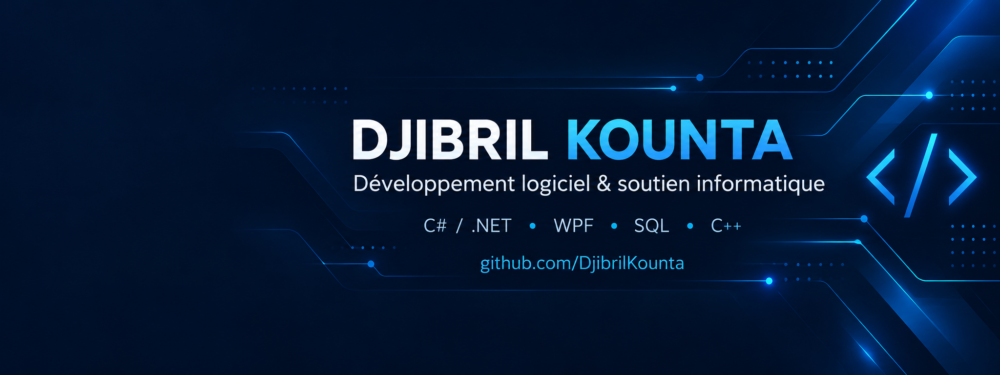

# Hi, I'm Djibril Kounta 👋

I'm interested in software development, with a focus on backend development and web technologies.

## About Me

- Based in Montréal, Canada
- Open to internships and junior software development opportunities

## Technical Skills

- **Languages:** C#, SQL, TypeScript
- **Frameworks:** .NET, ASP.NET Core, React
- **Tools:** Git, GitHub

## Selected Projects

- [Portfolio .NET](https://github.com/DjibrilKounta/Portfolio) — A web portfolio with an admin area for managing projects.
- [DiskMaster](https://github.com/DjibrilKounta/DiskMaster) — A C# utility for analyzing and cleaning up temporary files, with tests for cancellation and file-access errors.

## Connect With Me

- [LinkedIn](https://www.linkedin.com/in/djibrilkounta/)
